# zstack-engineering

面向编码 Agent 的工程工作流：从需求收敛、规范、技术设计、拆 ticket，到实现、调试、验证和审查。不绑定语言、框架或 Agent Runtime，项目自己的规则和验证入口留在目标仓库。

## 安装

```bash
claude plugin marketplace add calvingit/skills
claude plugin install zstack-engineering@calvingit
```

Codex：`codex plugin marketplace add calvingit/skills`，再 `codex plugin add zstack-engineering@calvingit`。ZCode 和更新、卸载的做法见 [INSTALL.md](../INSTALL.md)。

## 怎么用

大多数 skill 在任务匹配时由 Agent 自动选用；标了“用户手动调用”的（如 `how`、`why`、`show-me`、`visual-pr`）只在你点名时运行，Claude Code 里输入 `/名字`，Codex 里输入 `$名字`。不必走完所有阶段，按当前状态选入口，见下文“如何选用”。

## Skills

| Skill | 用途 |
| --- | --- |
| [`grilling`](./skills/grilling/SKILL.md) | 访谈收敛尚未决定的需求与选择。 |
| [`wayfinding`](./skills/wayfinding/SKILL.md) | 跨会话理清依赖决策与探索路径。 |
| [`to-spec`](./skills/to-spec/SKILL.md) | 把已确认需求写成规范性 SPEC。 |
| [`solution-design`](./skills/solution-design/SKILL.md) | 对照 SPEC 与代码库确定或修订技术方案和设计决策。 |
| [`to-tickets`](./skills/to-tickets/SKILL.md) | 拆出可调度的交付 ticket 图；ticket 是稳定交付契约。 |
| [`graph-workflow`](./skills/graph-workflow/SKILL.md) | 推进 ticket 图：派发（默认 serial，用户可显式要求 swarm）、证据与 `.loop/state.json` 运行状态。 |
| [`quick-implement`](./skills/quick-implement/SKILL.md) | 无需执行图的小范围入口，不替代 graph-workflow；实现后收尾验证与审查。 |
| [`ticket-implement`](./skills/ticket-implement/SKILL.md) | 在约定写范围内实现单张 ticket。 |
| [`tdd`](./skills/tdd/SKILL.md) | 用红-绿-重构驱动单个行为。 |
| [`verify`](./skills/verify/SKILL.md) | 独立按 AC 判断 PASS/FAIL/NOT VERIFIED。 |
| [`code-review`](./skills/code-review/SKILL.md) | 审查缺陷、回归与无必要复杂度。 |
| [`simplify`](./skills/simplify/SKILL.md) | 审查或去掉无当前职责的复杂度。 |
| [`debug`](./skills/debug/SKILL.md) | 复现与诊断疑难缺陷（修复需授权）。 |
| [`test-audit`](./skills/test-audit/SKILL.md) | 审计测试有效性与维护成本。 |
| [`project-setup`](./skills/project-setup/SKILL.md) | 探测并持久化工程 Profile。 |
| [`verification-setup`](./skills/verification-setup/SKILL.md) | 从仓库证据盘点、建立或刷新本地验证方法。 |
| [`domain-modeling`](./skills/domain-modeling/SKILL.md) | 术语表与长期架构决策。 |
| [`codebase-design`](./skills/codebase-design/SKILL.md) | 深模块、缝与依赖方向的共用词汇。 |
| [`review-architecture`](./skills/review-architecture/SKILL.md) | 只读架构符合性审查与候选发现。 |
| [`challenge`](./skills/challenge/SKILL.md) | 对已有方案做有边界的对抗式审查。 |
| [`tech-research`](./skills/tech-research/SKILL.md) | 基于证据的技术调研与选型建议。 |
| [`find-docs`](./skills/find-docs/SKILL.md) | 按版本查找官方文档。 |
| [`how`](./skills/how/SKILL.md) | 用户手动调用：解释当前代码如何运行。 |
| [`why`](./skills/why/SKILL.md) | 用户手动调用：追查设计或限制成因。 |
| [`show-me`](./skills/show-me/SKILL.md) | 按理解难点选择最小必要的文本、表格、图示、图片或交互式 HTML。 |
| [`visual-pr`](./skills/visual-pr/SKILL.md) | 用户手动调用：起草带结构图的 PR 描述，只给出文本，不改 PR。 |
| [`improve-agents-md`](./skills/improve-agents-md/SKILL.md) | 创建或优化多工具适用的 AGENTS.md。 |
| [`context-audit`](./skills/context-audit/SKILL.md) | 审查 Agent 上下文中的重复、冲突、过时内容和职责错位。 |
| [`agent-tool`](./skills/agent-tool/SKILL.md) | 手动调用 Claude Code、Codex、Kimi、Pi 或 Grok 的统一 CLI 封装。 |
| [`fuck-my-shit-mountain`](./skills/fuck-my-shit-mountain/SKILL.md) | Project Audit：多维证据审计；仅显式调用（目录名保持兼容，界面显示名为 Project Audit）。 |

共享契约、ticket graph 和状态脚本在 [`skills/shared/`](./skills/shared/)（`check.py` 跑测试），它不是 skill。Graph Workflow 与 Runtime 的说明和图示在 [`docs/`](./docs/)。

## Engineering Kernel

[Engineering Kernel](./skills/shared/ENGINEERING_KERNEL.md) 是跨 Skill 的不变量基线（范围、知识、决策、行动、证据）。它不代替项目契约、角色写入边界或强制门禁。

## 职责

[Engineering Responsibilities](./skills/shared/engineering-responsibilities.md) 回答“谁负责什么”：每个 Skill 能做哪些决定、写哪些产物、哪些事实以谁为准。跨 Skill 交接的目标、范围、验收和边界见[任务契约](./skills/shared/task-contract.md)。

## 调用关系

[Engineering Invocation](./skills/shared/engineering-invocation.md) 回答“谁可以调用谁”：用户入口、受调度角色和辅助能力三类，以及 graph-workflow、ticket-implement、verify 的调用规则。Graph Workflow 与 Runtime 的关系见 [Graph Workflow 与 Runtime](./docs/graph-workflow-runtime.md)。

## 如何选用

完整规则见 [Engineering Skills Guide](./skills/shared/engineering-skills.md)。按当前目标选入口，不必走完所有阶段：

| 当前状态 | 入口 |
| --- | --- |
| 需求、边界或验收未收敛 | [`grilling`](./skills/grilling/SKILL.md) |
| 技术路径要跨会话理清 | [`wayfinding`](./skills/wayfinding/SKILL.md) |
| 需要持久化规范 | [`to-spec`](./skills/to-spec/SKILL.md) |
| 多模块方案设计约束 | [`solution-design`](./skills/solution-design/SKILL.md) |
| 多执行单元与调度 | [`to-tickets`](./skills/to-tickets/SKILL.md) → [`graph-workflow`](./skills/graph-workflow/SKILL.md) |
| 单一范围、无执行图 | [`quick-implement`](./skills/quick-implement/SKILL.md) |
| 缺可重复验证方法 | [`verification-setup`](./skills/verification-setup/SKILL.md) |

入口按风险选择的规则见[流程选择](./skills/shared/workflow-policy.md)。

[](./docs/diagrams/engineering-workflow.svg)

[](./docs/diagrams/ticket-lifecycle.svg)
